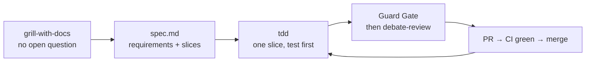

# The CoreX loop

CoreX is built **spec-first**: a spec is written and reviewed before the code (constitution, Principle X).
Since constitution v2.0.0 (DECISIONS #621) the steps are Matt Pocock's engineering skills around one spec
file per feature, instead of Spec Kit's command chain. The authoritative description is
[`AGENTS.md`](../../../AGENTS.md) ("The CoreX loop"); the model and effort each step runs on is in
[`CLAUDE.md`](../../../CLAUDE.md) ("Models, effort and agents"). This page is the working summary.

## The loop



| Step | Produces | Rule |
|---|---|---|
| `grill-with-docs` | answers to every open question; terms in `docs/_glossary.md`, decisions in `DECISIONS.md` | one question at a time, before the spec |
| `research` | `specs/NNN-name/research.md` | only when the spec depends on outside facts |
| Spec | `specs/NNN-name/spec.md`: requirements with IDs, then slices | each slice is one PR and names what it waits on |
| `wizard` | a script for the steps only the owner can do | each step is checked before the next |
| Claude Design | for anything a person sees: the approved design, on the CoreX design system, every state, 1280px and 375px, light and dark, both directions | required; handed off in `design/handoffs/` |
| `tdd` | one slice: a failing test per requirement, then the code; UI with `ui-ux-pro-max` | `diagnosing-bugs` first when it is a bug |
| Measure and UI review | browser assertions, `npm run test:quality`, `corex-ui-reviewer`, `design:accessibility-review`, `design:ux-copy` | required for anything a person sees |
| Guard Gate, `debate-review --local` | guard results; findings one model raised and another could not disprove | no diff ships before both |
| `pr`, `babysit-pr` | the pull request and its review rounds | CI green before merge |
| `retro` | what to change, recorded in `DECISIONS.md` | after a release or a session that went wrong |

The `/speckit-*` commands are retired. A spec that already has a `tasks.md` may finish its slices from it.

## The rules that never bend

- **No code before its spec.** If you are tempted to skip ahead and build it, open the spec first
  ([why](../../../DECISIONS.md): the compliance review that produced specs 018 to 024).
- **Every response ends with a `NEXT STEP` block** (Just completed / Recommended next / Why / Alternatives) so
  any teammate, or the next agent session, can resume.
- **Continuity lives in files:** `PROGRESS.md` (status and next) and `DECISIONS.md` (why we chose X) are updated
  every session. Chat is disposable; these files are the project's memory.
- **Multi-agent work has explicit ownership:** every active work unit records branch, spec path, slice, and
  files owned before edits. Agents never commit; the session that sent them reviews the diff, runs the guards
  and commits.

## Conflicts win upward

If a request conflicts with the rules, the agent **surfaces the conflict and stops** rather than silently
choosing. The source-of-truth order ([`COREX-WORKING-GUIDE.md` §A.1](../../internal/COREX-WORKING-GUIDE.md)):

```text
1. specs/constitution.md   2. docs/internal/COREX-FRAMEWORK.md   3. the active spec
4. PROGRESS.md             5. the code
```

## Where the specs live

`specs/NNN-name/`: each holds `spec.md`, and `research.md` when there was research. Specs written before
v2.0.0 also hold `plan.md`, `tasks.md` and checklists. Browse [`specs/`](../../../specs/).

## Example handoff

```text
Branch: spec/NNN-name
Spec: specs/NNN-name
Slices completed: 1 of 3
Files owned: plugins/corex-config/src/Docs/DocsUrl.php, tests/Unit/Config/DocsUrlTest.php
Verification: composer test -- --filter DocsUrl
Guards: clean-code-guard, wp-guard, test-guard clean; debate-review: no finding survived
Next owner may edit: README.md
```

## See also

- [Quality gates](./quality-gates.md) · [Branching & commits](./branching-and-commits.md) ·
  [`COREX-WORKING-GUIDE.md` Part D](../../internal/COREX-WORKING-GUIDE.md)
