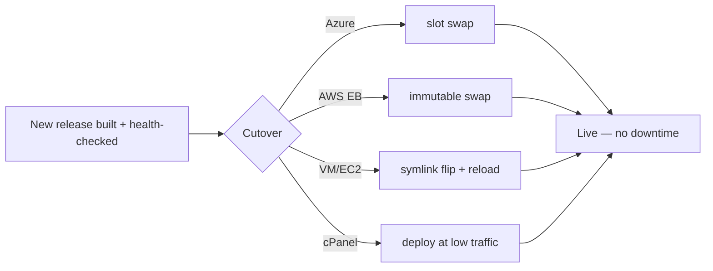

# Secrets, backups, rollback & zero-downtime

These practices apply to **every** target. The per-target recipes show the exact commands; this page is the
principles behind them, in one place.

## Secrets

**Never** commit a secret or paste it into a plain config field. The pattern is the same everywhere: store the
secret in a manager, reference it at runtime.

| Target | Where secrets live |
|---|---|
| Azure | **Key Vault** (App Settings use `@Microsoft.KeyVault(SecretUri=…)` references) |
| AWS | **Systems Manager Parameter Store** (SecureString) or Secrets Manager |
| VM / EC2 | a `.env` in the release directory, which is outside the web root, readable only by the user PHP runs as ([where it is read from](#where-the-env-file-is-read-from)); or the cloud secret manager via the instance role |
| cPanel | `wp-config.php` outside version control, file permissions `600` |
| CI | the runner's secret store (GitHub Actions secrets / Azure Pipelines variable groups) |

What counts as a secret on a Corex site: the database password, SMTP credentials, any third-party API keys
configured in **corex-config** settings, and captcha secret keys. The first two are not CoreX's to read: the
database password is in `wp-config.php`, and SMTP credentials are held by the site's SMTP plugin. The last two
are config keys. The framework reads them through the
[Config engine](../../README.md#what-lives-where) (`.env` → options → defaults), so they never need to be
hard-coded.

```bash
# .env on a VM (mode 600, outside the web root) — read by the Config engine
APP_ENV=production
FEATURES_MAIL_QUEUE=1
```

```text
(loaded at boot; never committed — see .gitignore)
```

### Where the `.env` file is read from

CoreX reads one file named `.env`, from one directory: the directory two levels above the real location of the
`corex-core` plugin. It looks nowhere else. Which directory that is depends on how the plugin got into WordPress:

| `corex-core` is | The `.env` is read from | Inside the web root? |
|---|---|---|
| **linked** into `wp-content/plugins/`: a development checkout, and the [Azure VM](./azure-vm.md) and [AWS EC2](./aws-ec2-rds.md) recipes | the repository, which on those servers is the release directory, `/var/www/corex/releases/<tag>/` | No. The web root is the `wp/` directory inside it |
| **copied** into `wp-content/plugins/`: the [shared-host package](./shared-host-dist.md) and the production [Docker image](./docker.md#the-production-image) | `wp-content/` | **Yes** |

**Linked.** The sample above belongs in the release directory. Every release is a new directory, so put the file
into each one before you move `current` to it. Give it to the user PHP runs as, and to nobody else:

```bash
sudo chown www-data:www-data /var/www/corex/releases/v0.19.0/.env
sudo chmod 600 /var/www/corex/releases/v0.19.0/.env
```

```text
(no output on success)
```

A `.env` that PHP cannot read is treated as if it were not there, and nothing is logged. A file owned by `root`
with mode `600` is such a file when PHP runs as `www-data`.

On a development machine, check that no other site of the web server has the repository under its document
root. WAMP's default `localhost` site serves everything under `www/`, a repository there included.

**Copied.** Do not create a `.env`. The only place it would be read from is `wp-content/.env`, and a web server
gives that file to anybody who asks for it unless it has been told not to: Apache with its stock configuration
answers the request with the whole file. A `.env` beside `wp-config.php`, or in the directory above the web root,
is not read. Set each key as its WordPress option instead: on the settings screen where the key has a field,
otherwise with `wp option update corex_<key_with_underscores>` (see
[the configuration guide](../../../docs-app/src/content/docs/guides/configuration.md)).

If a copied install already has a `wp-content/.env`, move its values to options and delete the file. Until it is
deleted, make the server refuse it. On Apache 2.4, in the `.htaccess` of the web root:

```apache
<Files ".env">
    Require all denied
</Files>
```

```text
(a request for /wp-content/.env is answered 403)
```

**Environment variables are not read.** A value set in the server's environment (App Service application
settings, Elastic Beanstalk environment properties, a container's `environment:`) does not set a CoreX config key.
`APP_NAME=Example` in the environment of the PHP process leaves `Config::get('app.name')` as it was.

## Backups

Back up **two** things — they are separate:

1. **The database** — the source of truth for content and settings. Logical dump or managed snapshots:

   ```bash
   mysqldump corex | gzip > corex-$(date +%F).sql.gz      # VM / cPanel
   aws rds create-db-snapshot --db-instance-identifier corex-db --db-snapshot-identifier corex-$(date +%F)  # AWS
   ```

   ```text
   (a dated, restorable backup)
   ```

2. **The uploads** (`wp-content/uploads`) — user-uploaded media, which is **not** in the image or the repo.
   Store it on object storage (S3 / Azure Blob) or back it up on the same schedule as the database.

> Code is **not** a backup concern — it is rebuilt from a git **tag**. Only the database and uploads are state.

Test a restore periodically; a backup you have never restored is a hope, not a backup.

## Rollback

Rollback strategy follows the deploy strategy:

| Deploy model | Rollback |
|---|---|
| Slot swap (Azure App Service) | swap back — instant |
| Immutable (AWS Beanstalk) | re-point to the previous application version — instant |
| Atomic release dir (VM / EC2) | flip the `current` symlink to the previous `releases/<tag>` + reload |
| Flat upload (cPanel) | repoint the document root to the previous tree + restore the DB backup |

In every case you roll **code** back to the previous **tag**. If the new release ran a data migration, restore
the matching **database** backup too — code rollback alone is not enough when the schema changed.

## Zero-downtime

The goal: users never hit a half-deployed site. The mechanism per target:



The common rule: **build and verify the new release fully before it serves any traffic**, then cut over
atomically. Shared hosting (cPanel) is the exception — it has no atomic swap, so deploy during low traffic and
keep the previous tree ready for an immediate repoint.

## See also

- [CI/CD](./ci-cd.md) · the per-target recipes ([Azure](./azure-app-service.md) · [AWS](./aws-beanstalk.md) ·
  [VM](./azure-vm.md) · [cPanel](./cpanel-shared-hosting.md))
